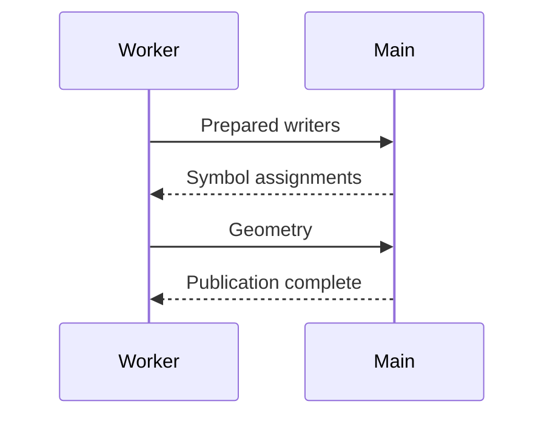
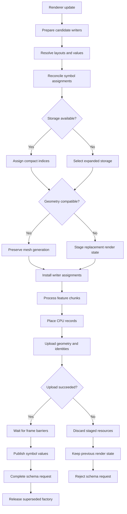

# Compact Mermaid rendering for Forge Harness

## Objective and current status

Investigate a fork of `mmdflux` that renders Mermaid diagrams as compact,
borderless Unicode text for Forge Harness plan review in Neovim.

The user wants node labels without surrounding boxes and straight downward
connections consisting of one `│` row followed by an arrowhead. Branches must
remain readable and preserve their labels.

This session researched upstream and exercised the installed CLI. No fork,
renderer implementation, or Harness integration exists from this work. The next
agent should investigate the layout implementation before estimating effort or
making changes. The user requested this handoff, not implementation approval.

## Original problem

The current Harness flow presentation combines execution steps, branches,
effects, and long qualified declaration names into wrapped lines. The screenshot
showed the schema-preparation flow from the `symbol-store-2` plan.

Two separate problems contribute:

1. Flow authoring puts implementation inventories and unchanged constraints into
   execution steps, obscuring the main sequence.
2. The generated presentation concatenates an effect's `change` and `target`
   without a readable separator. Trailing text is not necessarily irrelevant.

For example, the recorded structured effect was:

```json
{
  "target": "WriterPreparation",
  "change": "populate resolved static fields, physical layouts, structural paths, and geometry dependencies"
}
```

The rendered flow placed `WriterPreparation` after the change sentence.
Presenting effects as `target: change`, separately from execution arrows, avoids
this ambiguity.

Mermaid layout does not resolve overloaded content by itself. Keep short action
labels in diagrams and put field inventories, unchanged locking guarantees, and
detailed constraints in adjacent prose or declaration descriptions.

## User preference and proposed direction

The user explicitly suggested [mmdflux](https://github.com/kevinswiber/mmdflux)
and a possible fork rather than implementing a new Mermaid renderer in Harness.
The user then requested actual CLI renders, larger examples, and more compact
output.

The final preference is a borderless compact text style. This illustration is
the desired direction, not output produced by the installed renderer:

```text
Prepare candidate writers
            │
            ▼
Reconcile symbol assignments
            │
            ▼
     Storage available?
       ┌────┴────┐
      Yes        No
       │         │
       ▼         ▼
Assign indices   Use expanded storage
       └────┬────┘
            ▼
Install writer assignments
            │
            ▼
Process feature chunks
```

An optional compact text mode can preserve existing boxed text and SVG behavior.
Whether Mermaid replaces the current structured flow authoring contract, or is
generated from an extended contract, remains undecided. Do not treat either
approach as an accepted design.

## Installed CLI observations

The installed version on this machine is `mmdflux 2.6.1`.

The CLI accepts Mermaid on standard input and renders Unicode with:

```sh
mmdflux --format text --color off
```

Its help exposes `--rank-spacing`, `--node-spacing`, `--edge-spacing`,
`--margin`, `--padding`, and layout-engine selection. Do not assume those values
are terminal-cell counts without inspecting their implementation.

### Width support differs between upstream and this installation

The upstream README inspected during this session documents `--max-width`,
`--fit-direction keep`, and `render_diagram_fitted`. It says fitting can reduce
spacing, wrap labels, and transpose graph direction without losing content by
default. Sequence diagrams are measured but not compacted.

The installed 2.6.1 CLI rejects `--max-width`:

```text
error: unexpected argument '--max-width' found
```

Inspect the selected fork base and dependency version before relying on upstream
README features. Do not silently use `--fit-truncate` or another content-losing
fallback.

### Sequence diagrams

This actual input rendered a readable compact exchange:



Actual output:

```text
┌────────┐               ┌──────┐
│ Worker │               │ Main │
└────┬───┘               └───┬──┘
     │                       │
     │─Prepared writers─────>│
     │                       │
     │<┄Symbol assignments┄┄┄│
     │                       │
     │─Geometry─────────────>│
     │                       │
     │<┄Publication complete┄│
     │                       │
```

Long `Note over Worker` and `Note over Main` labels produced note boxes extending
across the other participant's lifeline. Short messages without long notes
avoided that problem. Sequence diagrams use a separate timeline renderer, so
graph-family layout changes should not be assumed to affect them.

### Flowcharts, state diagrams, and class diagrams

All four diagram families rendered in the installed version.

- Flowcharts express decisions and merge points.
- Sequence diagrams expose cross-thread request/response ordering.
- State diagrams express publication and discard transitions.
- Class diagrams express ownership and operations.

Default graph-family output reserves substantial vertical space. Consecutive
flowchart nodes had four `│` rows and one `▼` row between their boxes.
Left-to-right flowcharts reduced height but increased width.

Spacing experiments produced visibly misplaced connectors:

- `--rank-spacing 1 --node-spacing 2` distorted flowchart, state, and class output.
- `--rank-spacing 20 --node-spacing 20` also produced misplaced connectors in the
  tested top-to-bottom flowchart.

These are observed outputs, not a diagnosed root cause. Do not conclude that
upstream main has the same behavior without reproducing against the chosen base.

## Larger reproduction

This 22-node flowchart rendered successfully with defaults but consumed
substantial vertical space. It is an illustrative layout fixture based on the
plan, not a verified executable lifecycle contract.



## Upstream architecture inspected

Upstream provides a Rust library and CLI, Unicode/ASCII output, SVG, and MMDS
structured JSON. It includes a graph layout engine and terminal character canvas.
A browser or Node.js runtime is not required for native rendering.

The source investigation was limited to upstream main, not a locally checked-out
fork or the installed release's matching source.

| Source | Observed responsibility |
| --- | --- |
| [`src/render/graph/text/shape.rs`](https://github.com/kevinswiber/mmdflux/blob/main/src/render/graph/text/shape.rs) | Node and glyph drawing for graph text output. Imports `grid_node_dimensions` from graph measurement. |
| [`src/graph/measure.rs`](https://github.com/kevinswiber/mmdflux/blob/main/src/graph/measure.rs) | Shared graph-family measurement primitives. |
| [`src/render/graph/text/mod.rs`](https://github.com/kevinswiber/mmdflux/blob/main/src/render/graph/text/mod.rs) | Consumes grid layout, routes edges, paints nodes and edges, places labels, and measures the resulting canvas. |
| [`src/graph`](https://github.com/kevinswiber/mmdflux/tree/main/src/graph) | Contains graph/grid layout responsibilities that need deeper investigation. |
| [`src/render/text`](https://github.com/kevinswiber/mmdflux/tree/main/src/render/text) | Shared canvas, character sets, and connection primitives. |
| [`src/render/timeline`](https://github.com/kevinswiber/mmdflux/tree/main/src/render/timeline) | Separate sequence-diagram rendering area. |

`render_text_from_grid_layout_measured` in the graph text renderer calls
`route_all_edges`, allocates a canvas, draws nodes at `draw_positions`, and
renders routed edges with labels. This confirms that removing box glyphs alone
does not change node bounds or reserved spacing.

## Implementation boundaries to investigate

Coordinate measurement, placement, and rendering rather than postprocessing
finished text:

1. Measure borderless nodes using their visible labels and required multiline
   dimensions instead of boxed dimensions.
2. Draw labels without node borders or box padding.
3. Allocate one vertical line row and one arrowhead row for unobstructed
   downward connections.
4. Route edges against the revised node bounds, preserving space for branches,
   merges, edge labels, crossings, and subgraph titles.
5. Keep existing boxed and SVG behavior isolated from the optional text style.

Straight chains are the narrower change. General graph compaction also requires
multiline labels, cycles, nested subgraphs, branch joins, and non-downward
directions to remain correct. No reliable effort estimate has been established.

Do not delete repeated connector rows from the final string. Rows can carry
branch geometry or labels elsewhere on the canvas. Do not truncate diagram
content to fit the review window.

Potential Harness integration work remains separate:

- Decide whether to embed the Rust library or invoke the CLI.
- Determine how rendered cells map to plan nodes and declaration references for
  navigation, review comments, and highlighting.
- Inspect MMDS geometry before assuming it provides text-cell/source mappings.
- Preserve the previous usable view on render failure and expose diagnostics.
- Handle viewport width and scrolling without dropping diagram content.

## Relevant plan and session context

The original plan concerns main-thread-owned symbol storage for 2D rendering.
During schema updates, the worker prepares writers and values, awaits
main-thread assignments, installs those assignments, and only then emits
geometry. Publication waits for existing instance-store and frame barriers.
Compatible changes preserve assignments and mesh generation. Failed updates
must preserve the previous usable configuration.

These statements describe the inspected proposed plan, not completed code.

The original session is available through Harness history:

```text
Workspace:
  /Users/matt9222/Developer/webgis/matt9222/symbol-store-2
Session:
  64e5f236-3d52-4c4a-8440-d76e85163a45
Planning exchange:
  096b65d0-53a9-4296-91ac-ebef54461259
Plan:
  85cb18a3-d703-4915-805b-09437f0d1990
Recorded flow-authoring tool:
  call_monLbbEz8sodyOV5cBDxU1Ks
Recorded turn:
  096b65d0-53a9-4296-91ac-ebef54461259:turn:52
```

The flow-authoring record accepted canonical version 16. A later session answer
reported submission at version 23. Treat these as historical identifiers, not
the current active task or permission to revise that plan.

This discussion took place in the dotfiles repository `/Users/matt9222/config`.
Harness source lives in this repository under `nvim/rust/forge` and
`nvim/lua/forge`. Discover exact active source and settings locations with
`harness_config` if integration work follows.

## Links

- [mmdflux repository and README](https://github.com/kevinswiber/mmdflux)
- [Releases](https://github.com/kevinswiber/mmdflux/releases)
- [Gallery](https://github.com/kevinswiber/mmdflux/blob/main/docs/gallery.md)
- [MMDS specification](https://github.com/kevinswiber/mmdflux/blob/main/docs/mmds.md)
- [Playground](https://play.mmdflux.com)
- [Rust API documentation](https://docs.rs/mmdflux)
