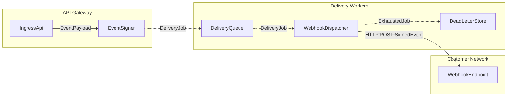
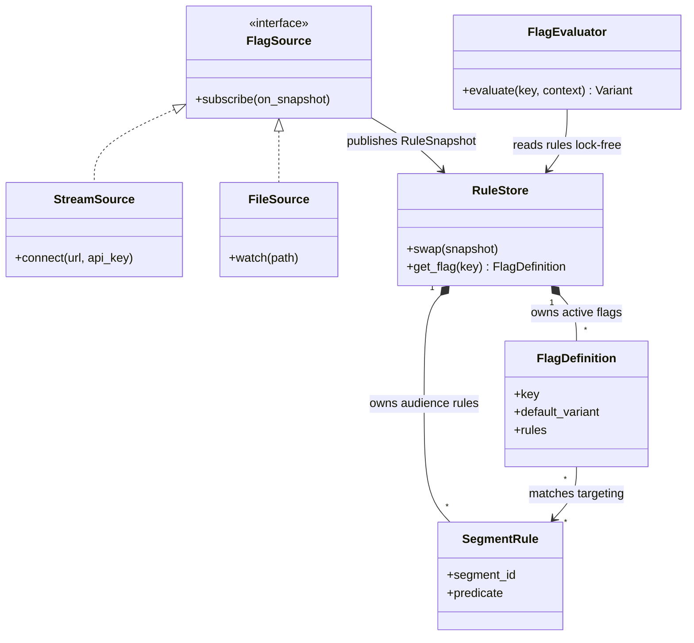

# Diagrams

*Read before adding or reviewing an architecture diagram, sequence chart, state diagram, or data-flow diagram.*

## Scope and Placement

- Use a diagram when layout shows structure, state transitions, or data flow more clearly than prose, answering one question per diagram.
- Place each diagram directly below a lead-in paragraph that states its takeaway, and keep contracts or copyable text (commands, paths, error codes) in prose or tables.
- Keep the longest arrow chain concise (around six nodes or fewer), splitting at ownership boundaries, network hops, or storage writes.

## Labels and Conventions

- Name components with short plain nouns (`IngestWorker`, `DocumentStore`) without parenthetical summaries, and name states with adjectives or past participles (`Queued`, `Claimed`, `DeadLettered`).
- Label arrows with what crosses them (`SignedEvent`, `HTTP POST /v1/events`) instead of vague verbs like *"calls"* or *"uses"*. Use solid arrows for synchronous calls and dashed arrows for asynchronous queues or events.
- Group separate processes, trust zones, or services in labeled subgraphs. Lay out hierarchies top-to-bottom and flows left-to-right, pairing color with shape, line style, or labels, and omit Mermaid `accTitle`/`accDescr` headers.
- In UML `classDiagram` blocks, include major architectural components with key `+method` boundaries, keep value payloads on arrow labels instead of separate boxes, and omit custom `<<...>>` lifetime stereotypes.

## Examples

### Data Flow Across Trust Zones

The gateway signs each event on the request path and hands a delivery job to an internal queue. Background workers post signed payloads to customer endpoints and route exhausted jobs to dead-letter storage:

### Ownership and Cardinality

Pluggable sources publish immutable rule snapshots into the rule store, letting the evaluator match flags against shared audience segments without holding write locks:

