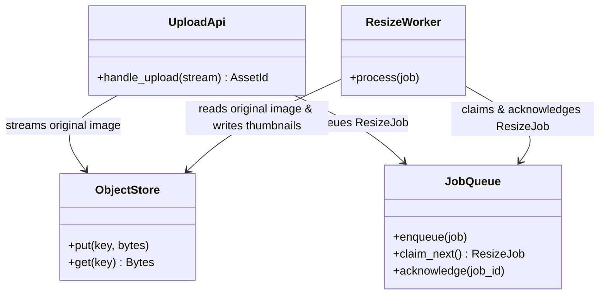
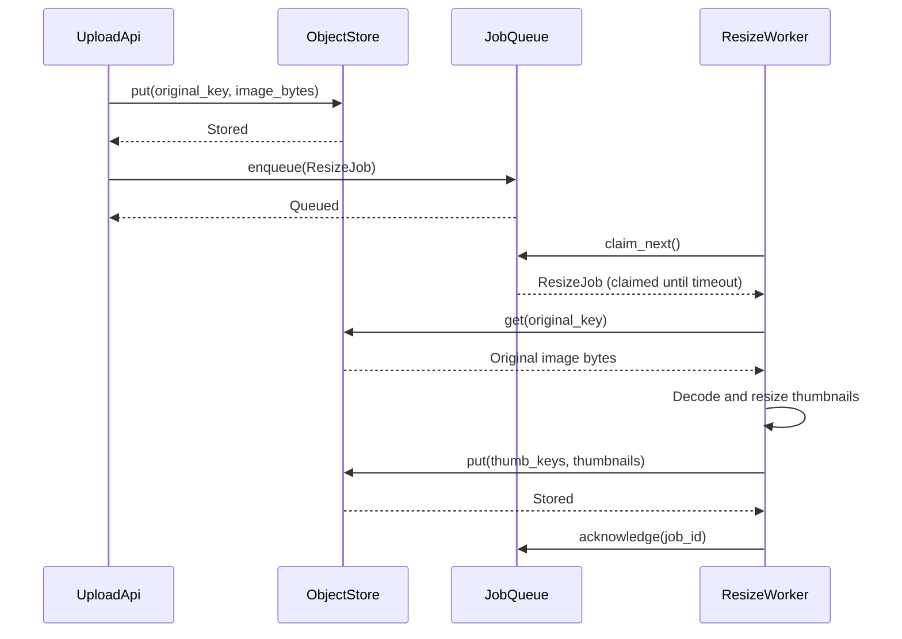
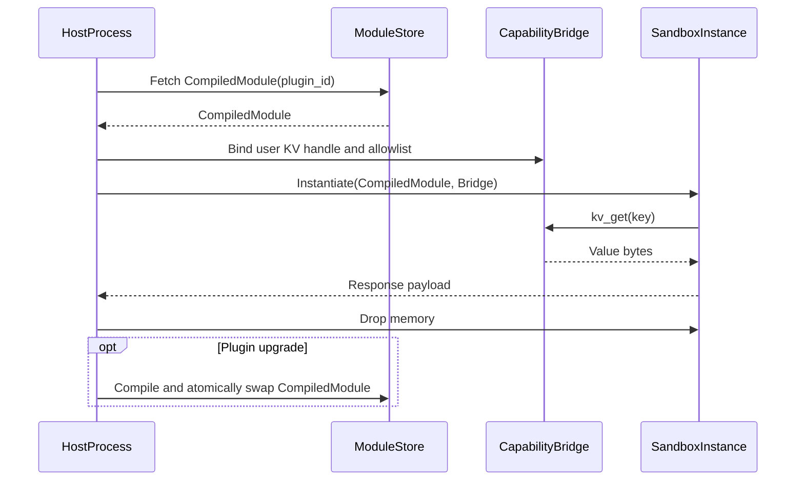
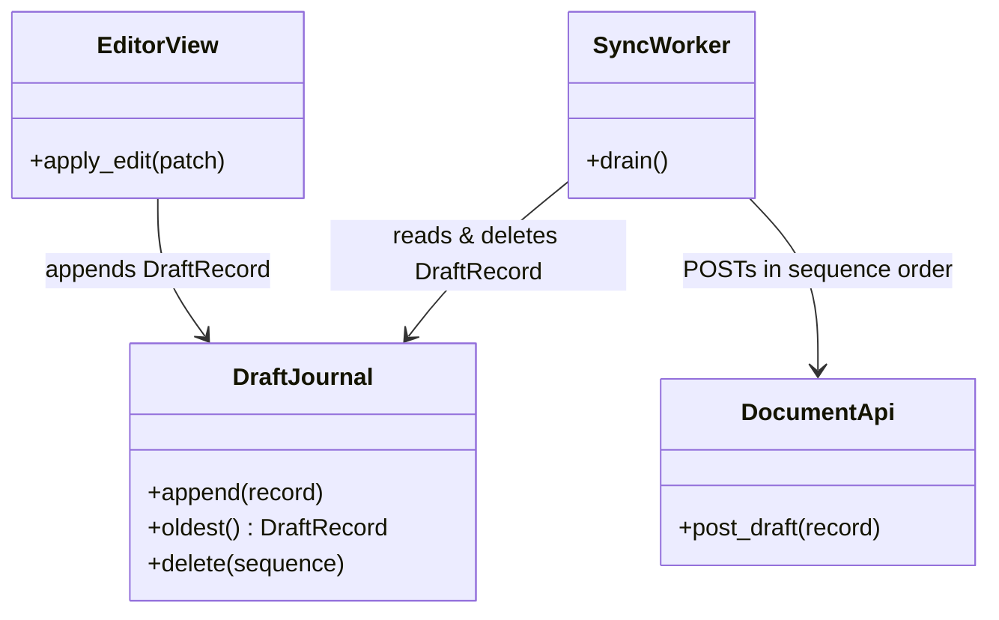
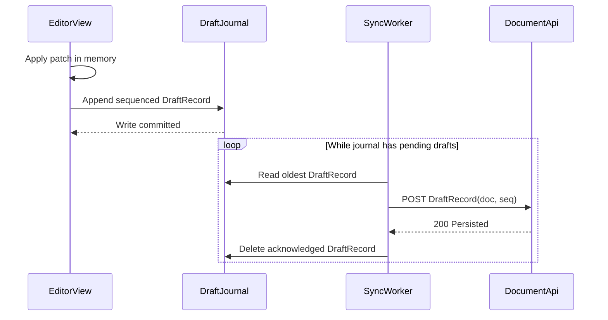

# Architectural Overview Profile

*Read when writing or revising an overview of a system's architecture, a subsystem design, or a major boundary.*

## Goal

Show how a system meets its requirements through four connected beats: **Purpose and Constraints → Ownership and Boundaries → Flows → Failure Boundaries**. A reader finishing an architectural overview should be able to predict where a new feature belongs, what crosses each boundary, and what happens when a component reloads, disconnects, or fails.

Write in a calm, matter-of-fact developer-to-developer voice (`we` is fine when explaining design choices). Use present indicative with definite subjects ("The scheduler...", not "A scheduler...") for the architecture that exists, and conditional mood (`would`, `could`) for rejected alternatives or unmitigated failure scenarios. Prefer flowing prose paragraphs and domain-named headings over bullet inventories or generic template labels such as "Components and Ownership" or "Failure Boundaries." Avoid words such as "intended," "proposed," or "future," except for an active migration that changes how callers use the system today.

## Guiding Structure

Adapt headings to the system's domain concepts while preserving this reading order so concepts and ownership come before flows and raw types.

### Problem and Constraints

- Ground the opening sentence in the user action or calling subsystem that needs this component (the "so what"—for example, an asset browser displaying preview grids or admins uploading moderation rules), then name the system in the next sentence if it is not already the subject. Then either state the architecture directly and explain what it buys (design-first, best for straightforward or multi-part systems) or briefly explain the single tempting shortcut or concrete constraint it addresses (single-contrast or problem-first). Never stack multiple rejected designs back-to-back before describing the real system, and avoid theatrical failure triplets or stacked `To X without Y` clauses.
- Keep this opening focused on plain behavior; defer concrete class names, undefined mechanism jargon, and exact edge-case qualifications (such as acknowledged vs. in-flight writes) to the sections that define them.
- Define unfamiliar domain terms where they first appear.

### Ownership and Boundaries

- Pick up directly from the opening paragraph's closing claim so the transition continues the same thread instead of restarting cold.
- Name the major components for the first time here, stating what each one owns and why those boundaries satisfy the constraints just introduced.
- When an abstraction or indirection exists to absorb real-world quirks (divergent provider behavior, OS watcher noise, lock contention), lead that paragraph with a brief empirical explanation of what happens in practice rather than a chronological history of past attempts—for example: *"Operating system file watchers rarely emit one clean event per save—editors write temporary files, rename them into place, and fire duplicate notifications within milliseconds. To avoid back-to-back rebuilds, the `WatchLoop` coalesces events over a short quiet window before notifying the `BuildRunner`."*
- When a diagram helps establish the static structure, use a standard UML Mermaid `classDiagram` containing **only the major architectural components** with their key boundary methods and labeled ownership arrows—keep value payloads on the arrows instead of adding boxes for small data structs.
- Use a comparison table only when scanning parallel modes or configurations with short cells, never to cram full behavioral paragraphs into a `Responsibility` column.

### Execution Flows

- Trace the flow chronologically from trigger to completion so each sentence picks up where the previous one ended. Add a one-sentence stage summary first only when the flow has distinct phases that would otherwise be hard to follow.
- Avoid re-arguing design motives already established earlier; state what triggers each handoff and what completes it.
- Pair a `sequenceDiagram` with that narrative, and include secondary paths (such as live reloads, upgrades, or retries) when they share the same boundary contract.
- Show a concrete boundary struct or short code snippet only where it defines the exact contract crossing between layers.

### Failure Boundaries and Limits

- Cover only the concurrency rules (thread ownership, lock scopes, task draining, ordering) and failure modes (missing dependencies, dropped links, full storage, worker crashes) that actually apply to this system, including recovery bounds and where guarantees stop holding.

## Leave Out

- Proposal history, rejected options, feasibility debates, roadmaps, and task checklists (put those in an RFC, ADR, or plan).
- Exhaustive method listings or function signatures that do not define a boundary between parts (put those in a Reference or API doc).
- Meta signposting ("This page documents..."), opening feature laundry lists, and inline struct-brace notation inside prose (`Record { a, b }`).

## Examples

Three complete mini architectural overviews showing how the opening adapts to the reader's first question: design-first when the architecture itself is straightforward (`Media Thumbnail Pipeline`), single-contrast when a simpler isolation mechanism is tempting (`Plugin Sandbox Host`), and problem-first when local persistence needs justification (`Offline Draft Sync`).

### Media Thumbnail Pipeline

````markdown
# Media Thumbnail Pipeline

The asset browser needs small thumbnails for uploaded images to quickly show asset previews without downloading full resolution files. On upload, it routes requests to the media service, which generates thumbnails for every image users upload. The endpoint writes files straight to object storage and queues a resize job for background workers. Keeping image decoding off the API servers prevents large uploads from starving other traffic.

## Separating Uploads from Image Processing

The `UploadApi` runs inside the API server, streaming each upload directly to the `ObjectStore` without decoding it, and recording a `ResizeJob` in the `JobQueue` once storage confirms the write. The `ObjectStore` holds both original uploads and thumbnails, keyed by asset ID and target dimensions.

Separate `ResizeWorker` processes handle decoding and resizing and scale independently of the API servers. Each `ResizeWorker` pulls one `ResizeJob` at a time from the `JobQueue`, and writes the finished thumbnails back to the `ObjectStore`.



## Uploading and Generating Thumbnails

Thumbnail generation runs in two stages: a synchronous upload path that persists the original file, followed by an asynchronous worker pass that produces the thumbnails. When a user uploads an image, the `UploadApi` validates the content type and size limit, streams the image bytes to the `ObjectStore`, and enqueues a `ResizeJob` carrying the asset ID and object key. Once the `JobQueue` accepts the job, the `UploadApi` returns the asset ID to the caller immediately.



In the background, an idle `ResizeWorker` claims the job, fetches the original file from the `ObjectStore`, and generates each thumbnail according to the requested size. The worker writes every thumbnail to the ObjectStore before acknowledging completion to JobQueue. If a client requests a thumbnail before the worker finishes, the serving layer returns a placeholder or falls back to the original image until the thumbnail generation completes.

## Worker Crashes and Corrupt Uploads

When a worker takes a job, the JobQueue hides it from other workers until a timeout expires. If a `ResizeWorker` crashes or is killed before acknowledging the job, the `JobQueue` makes the failed `ResizeJob` available to another worker. Because thumbnail keys are deterministic and `ObjectStore::put` overwrites atomically, re-running a partial job produces the same objects without leaving half-written files behind.

Malformed uploads can still fail decoding or request excessive memory during decompression. Each `ResizeWorker` checks image dimensions before allocating a decode buffer, and jobs that fail three attempts are set aside for inspection. At that point, the original upload remains in the `ObjectStore`, and the asset stays without thumbnails until an operator inspects or removes it.
````

### Plugin Sandbox Host

````markdown
# Plugin Sandbox Host

Community admins upload custom moderation rules that inspect incoming posts and check external blocklists before content is published. The plugin sandbox host runs those rules on incoming requests inside the API gateway. Spawning a fresh OS process per request would isolate untrusted code, but process startup would add tens of milliseconds to every call. Instead, the host runs extensions as WebAssembly modules in isolated memory. Each module compiles once on upload, and every request runs in a fresh sandbox.

## Isolating Execution Across Three Lifetimes

Everything runs inside one server process. The gateway isolates extensions by separating shared runtime state from per-request memory. The `HostProcess` holds onto an HTTP listener, worker threads, and WebAssembly engine. Alongside it, the `ModuleStore` stores the compiled `CompiledModule` for each uploaded plugin, sharing it across worker threads.

User permissions and mutable memory live only for a single request. Before invoking an extension, the `HostProcess` creates a `CapabilityBridge` scoped to the calling user. The bridge exposes only the handles that user can call (a namespaced key-value store, an HTTP allowlist, and a logger) rather than raw sockets or credentials. For each request, the `HostProcess` creates a `SandboxInstance` with its own memory, backed by the stored `CompiledModule` and that `CapabilityBridge`. Once the call returns, the `HostProcess` drops the instance and its memory, meaning that they live only for a single request.


## Invoking Requests and Deploying Upgrades

When a request arrives, the `HostProcess` fetches the plugin's `CompiledModule` from the `ModuleStore`, binds a `CapabilityBridge` for the user, and starts a `SandboxInstance`. During execution, host calls route through the bridge. Once the handler returns, the `HostProcess` drops the instance and reclaims its memory.



When a user uploads a new plugin version, the `ModuleStore` compiles the replacement binary in the background and swaps the stored module atomically. New requests pick up the updated `CompiledModule`, while any in-flight `SandboxInstance` finishes on the previous version before being dropped.

## Handling Runaway Extensions

Each `SandboxInstance` runs with an execution timeout and a 64 MiB memory limit. Exceeding those limits or crashing stops only that instance. The `HostProcess` reclaims its memory, logs the error, and returns `502 Bad Gateway` for that request while other users continue unaffected.

Sandbox timeouts only trigger while WebAssembly code is running, not while an extension is blocked inside a host call. To keep a slow upstream from pinning a worker thread, every network and storage method on the `CapabilityBridge` enforces its own deadline.
````

### Offline Draft Sync

````markdown
# Offline Draft Sync

When users type, the document editor applies every keystroke directly to an in-memory store instead of waiting on network I/O. Because those edits are not confirmed by the server right away, unsent changes would be lost if the editor tab crashes or the network drops. To avoid losing unsent edits, we save drafts to a local database and upload them in the background.

## Splitting Local Edits from Background Sync

The editor separates local persistence from background upload by routing both through the DraftJournal. The EditorView holds the open document in memory. On each edit, it updates that state and appends a sequenced DraftRecord to the DraftJournal. The journal saves unconfirmed records in an IndexedDB object store, indexed by document ID and sequence number. This prevents a stalled save on one document from delaying others.

The SyncWorker is the only caller of the DocumentApi. It sends pending records from the DraftJournal in sequence order, waiting for the server to confirm each save before deleting the record and sending the next.



## Recording and Syncing a Draft

When the user types, the EditorView updates the document in memory, assigns the next sequence number, and writes a DraftRecord to the DraftJournal. That write wakes the SyncWorker, which reads the oldest pending record for that document and posts it to the DocumentApi. Once the server confirms the save, the worker deletes the record and moves on to the next one. The worker also runs on tab startup and reconnect.



If the browser closes anywhere between the journal commit and the server acknowledgment, the next session restarts the `SyncWorker` and replays every unacknowledged record from the sequence number where the prior tab stopped.

## Outages and Storage Quotas

When the network drops or the `DocumentApi` returns a server error, the `SyncWorker` leaves the pending draft in the `DraftJournal` and retries with exponential backoff capped at 30 seconds while the `EditorView` continues accepting local edits.

Local drafts are limited by the browser's storage quota. When IndexedDB rejects a write, the EditorView marks the document unsaved and warns that new edits will not survive a reload.
````
