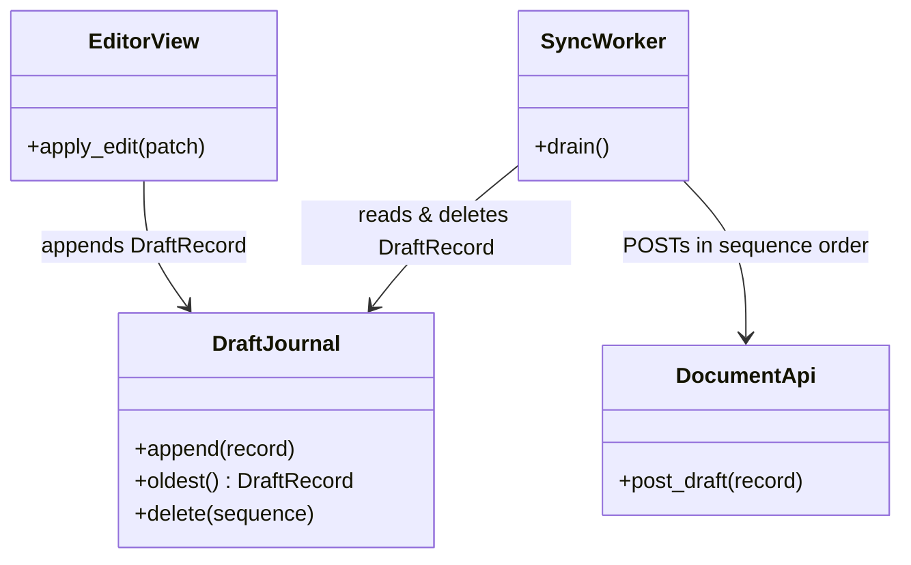
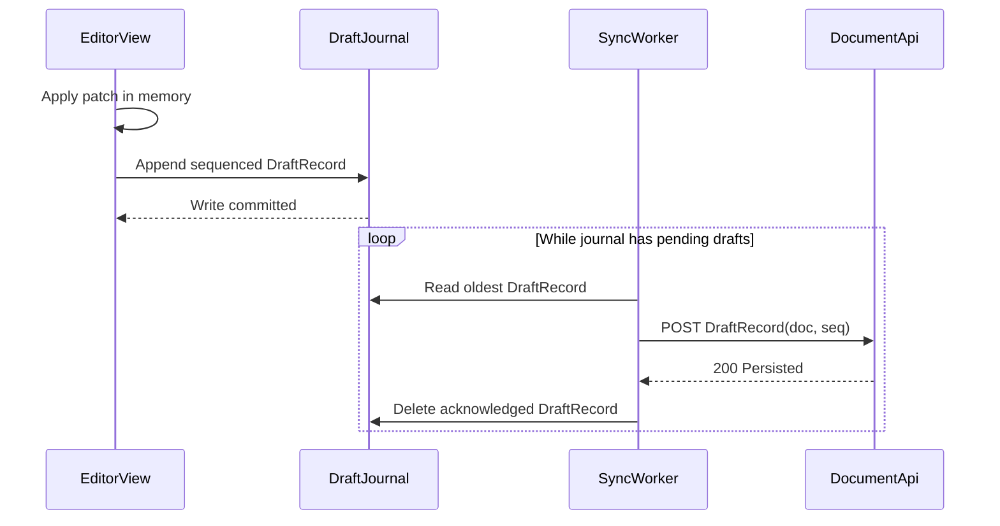
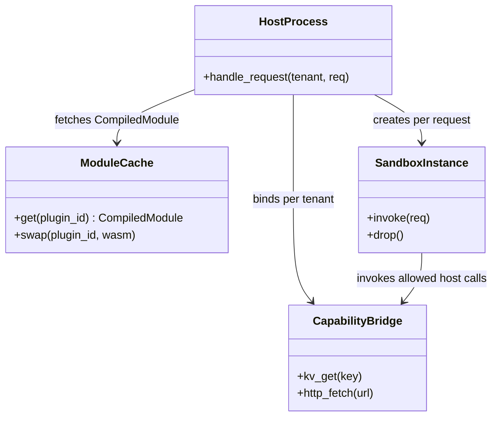
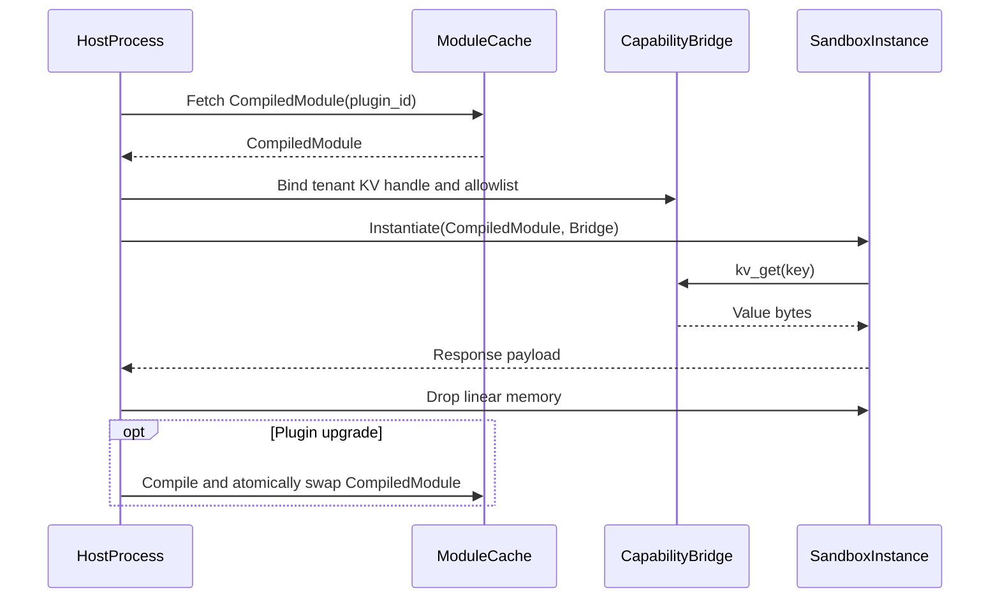

# Architectural Overview Profile

*Read when writing or revising an overview of a system's architecture, a subsystem design, or a major boundary.*

## Goal

Show how a system meets its requirements through four connected beats: **Constraints → Ownership and Lifetime Hierarchy → Flows → Failure Boundaries**. A reader finishing an architectural overview should be able to predict where a new feature belongs, what crosses each boundary, and what happens when a component reloads, disconnects, or fails.

Write in the present tense. Prefer flowing prose paragraphs and domain-named headings over bullet inventories or generic template labels such as "Components and Ownership" or "Failure Boundaries." Avoid words such as "intended," "proposed," or "future," except for an active migration that changes how callers use the system today.

## Guiding Structure

Adapt headings to the system's domain concepts while preserving this reading order so concepts and lifetimes come before flows and raw types.

### Problem and Constraints

- Open directly on the system being documented, the tension it must resolve, and what fails under a realistic naive design.
- Keep this opening focused on behavior and guarantees; defer concrete class and module names to the next section.
- Define unfamiliar domain terms where they first appear.

### Ownership and Lifetime Hierarchy

- Pick up directly from the opening paragraph's closing claim so the transition continues the same thread instead of restarting cold.
- Name the major components for the first time here, stating what each one owns, how long it lives, and why those boundaries satisfy the constraints just introduced.
- When a diagram helps establish the static structure, use a standard UML Mermaid `classDiagram` containing **only the major architectural components** with their key boundary methods and labeled ownership arrows—keep value payloads on the arrows instead of adding boxes for small data structs.
- Use a comparison table only when scanning parallel modes or configurations with short cells, never to cram full behavioral paragraphs into a `Responsibility` column.

### Execution Flows

- Open the flow with a plain summary of its stages (for example, "two stages: a local journal write followed by an asynchronous upload"), then trace chronologically from trigger to completion so each sentence picks up where the previous one ended.
- Avoid re-arguing design motives already established earlier; state what triggers each handoff and what completes it.
- Pair a `sequenceDiagram` with that narrative, and include secondary paths (such as live reloads, upgrades, or retries) when they share the same boundary contract.
- Show a concrete boundary struct or short code snippet only where it defines the exact contract crossing between layers.

### Failure Boundaries and Limits

- Describe thread ownership, lock scopes, task draining, or ordering rules that prevent races.
- State what happens when a dependency is missing, a network link drops, storage fills, or a worker crashes, including recovery bounds and where guarantees stop holding.

## Leave Out

- Proposal history, rejected options, feasibility debates, roadmaps, and task checklists (put those in an RFC, ADR, or plan).
- Exhaustive method listings or function signatures that do not define a boundary between parts (put those in a Reference or API doc).
- Meta signposting ("This page documents..."), opening feature laundry lists, and inline struct-brace notation inside prose (`Record { a, b }`).

## Examples

Two complete mini architectural overviews showing how the same four-part spine adapts to an asynchronous persistence pipeline and a multi-lifetime runtime host.

### Offline Draft Sync

````markdown
# Offline Draft Sync

The document editor updates its in-memory state on every keystroke so typing stays responsive, but this leaves a gap before those changes reach the server. When autosave reads only from memory, a tab crash, reload, or network outage wipes out every unconfirmed edit. To close that gap without tying typing to the network, the editor persists drafts locally and uploads them in the background.

## Splitting Local Edits from Background Sync

Local persistence and background upload stay decoupled by communicating strictly through the `DraftJournal` in IndexedDB. The `EditorView` owns the open document in memory for the life of the tab; on each edit, it updates that state immediately and appends a sequenced `DraftRecord` to the journal. The `DraftJournal` owns all unconfirmed records on disk—stored in one IndexedDB object store per document—so unsent edits survive crashes and reloads, and a stalled save on one document never delays another.

The `SyncWorker` owns all background uploads to the `DocumentApi`, reading pending records from the journal in sequence order and deleting each entry only after the server confirms persistence. Because the `SyncWorker` is the sole caller of the `DocumentApi` and waits for confirmation before sending the next record, two save requests for the same document never race.



## Recording and Syncing a Draft

Saving happens in two stages: a local journal write on each edit, followed by an asynchronous upload in the background. When the user types, the `EditorView` applies the patch in memory immediately, assigns the next sequence number, and writes a `DraftRecord` to the `DraftJournal`. That write wakes the `SyncWorker`—which also runs on tab startup and reconnect—to read the oldest pending record for that document and post it to the `DocumentApi`. Once the server confirms persistence, the worker deletes the local record and moves on to the next one.



If the browser closes anywhere between the journal commit and the server acknowledgment, the next session restarts the `SyncWorker` and replays every unacknowledged record from the exact sequence number where the prior tab stopped.

## Outages and Storage Quotas

When the network drops or the `DocumentApi` returns a server error, the `SyncWorker` leaves the pending draft in the `DraftJournal` and retries with exponential backoff capped at 30 seconds while the `EditorView` continues accepting local edits normally.

Local durability stops at the browser's storage quota. If IndexedDB rejects an append because disk space is exhausted, the `EditorView` marks the document unsaved and displays a blocking storage warning so the user knows new changes will not survive a reload until space is freed.
````

### Plugin Sandbox Host

````markdown
# Plugin Sandbox Host

The API gateway runs user-authored extensions on the request path, but executing untrusted code directly inside the server process lets a single panic, infinite loop, or memory bug crash the server or expose another tenant's secrets. Isolating extensions by spawning a fresh OS process on every request keeps tenants apart, but process startup adds tens of milliseconds to every call. To keep invocation fast without sharing mutable state across requests, the gateway precompiles uploaded WebAssembly plugins once and runs each request inside a short-lived sandbox.

## Isolating Execution Across Three Lifetimes

Fast invocation and tenant isolation hold together by separating long-lived runtime infrastructure from disposable per-request memory. The `HostProcess` owns the HTTP listener, worker threads, and WebAssembly engine for the life of the OS process, never executing guest bytecode directly. Alongside it, the `ModuleCache` owns compiled native code for every uploaded plugin, storing immutable `CompiledModule` values shared safely across worker threads so individual requests never pay compilation overhead.

Everything tenant-specific or mutable lives strictly shorter. Before invoking an extension, the `HostProcess` creates a `CapabilityBridge` scoped to the calling tenant; the bridge owns the narrow host handles that tenant is permitted to call—a namespaced key-value store, an outbound HTTP allowlist, and a logger—without exposing raw sockets or credentials to guest memory. For each request, the runtime creates a `SandboxInstance` owning a fresh linear memory buffer bound to the cached `CompiledModule` and that `CapabilityBridge`, then drops the instance as soon as the call returns so state never leaks between requests.



## Invoking Requests and Deploying Upgrades

Handling a request takes two steps: binding a fresh sandbox to a precompiled module, then dropping its memory as soon as the response returns. When a request arrives, the `HostProcess` fetches the plugin's `CompiledModule` from the `ModuleCache`, binds a tenant-scoped `CapabilityBridge`, and instantiates a `SandboxInstance`. During execution, any permitted host call routes through the bridge; once the handler returns, the host drops the instance and reclaims its linear memory.



When a tenant uploads a new plugin version, the `ModuleCache` compiles the replacement binary in the background and swaps the cache entry atomically. New requests immediately pick up the updated `CompiledModule`, while any in-flight `SandboxInstance` finishes against the previous compiled code and releases its reference on drop.

## Trapping Runaway Extensions

Every `SandboxInstance` runs with a hard CPU fuel budget and a 64 MiB linear memory ceiling. An infinite loop, out-of-memory allocation, or guest panic traps only that instance: the `HostProcess` reclaims its memory, logs the trap diagnostic, and returns `502 Bad Gateway` for that request while other tenants continue unaffected.

Guest fuel stops ticking while an extension is blocked waiting on a host call. Every network or storage method on the `CapabilityBridge` therefore enforces its own deadline independent of the sandbox fuel budget so a slow upstream cannot pin a worker thread indefinitely.
````
