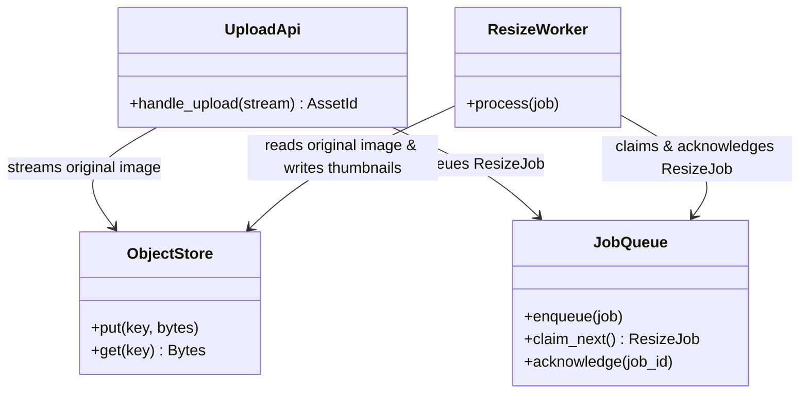
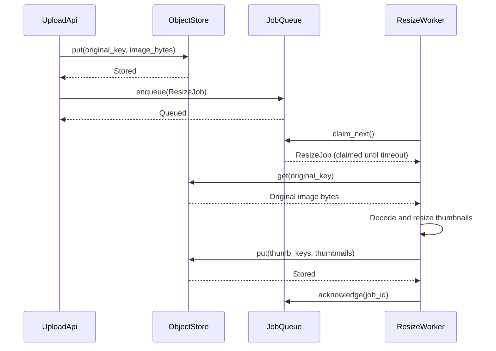
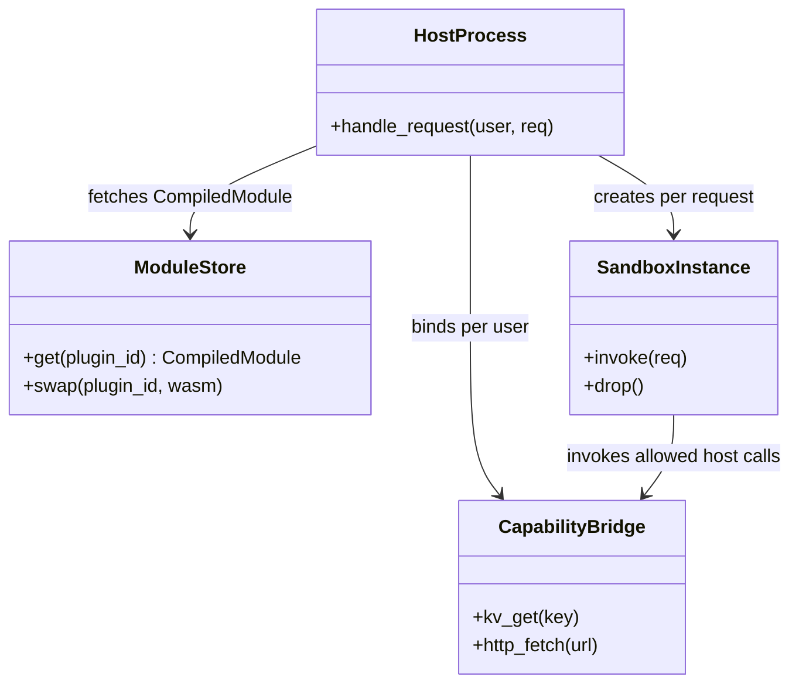
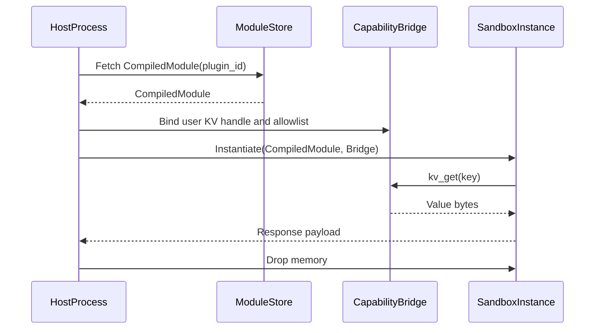
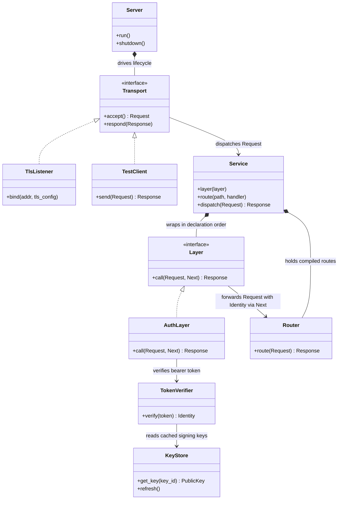

# Architecture Profile

*Read when writing or revising an overview of a system's architecture, a subsystem design, or a major boundary.*

## Goal

Build a mental model of how a system is structured and how its parts interact. A reader finishing an architectural overview should understand what each major part owns, how data or control flows across them, and—where applicable—the limits or failure modes that shape the design.

## Guiding Structure

Adapt headings and section count to the system's domain concepts, introducing core roles and ownership before detailed execution paths and edge cases.

### Opening

- Establish what the system is, what it does, and the scope of the page. Lead directly with its role when the need is obvious, bridge from a neighboring concept when it complements another subsystem, or open with the motivating problem or paradigm when the design would otherwise look arbitrary.
- Keep the opening focused on the core idea—include a load-bearing type when it clarifies the concept, or a short entry-point snippet when the page centers on a public or widely used internal API, and save internal types, deep mechanics, and edge-case qualifications for the sections that explain them.

### Ownership and Boundaries

- Continue from the opening so the first body section develops the same thread rather than restarting cold.
- When an abstraction exists to absorb real-world quirks (divergent provider behavior, OS watcher noise, lock contention), lead that paragraph with a brief empirical explanation of what happens in practice rather than a chronological history of past attempts—for example: *"Operating system file watchers rarely emit one clean event per save—editors write temporary files, rename them into place, and fire duplicate notifications within milliseconds. To avoid back-to-back rebuilds, the watch loop collapses rapid bursts into a single notification for the build runner."*
- When a diagram helps establish static structure, use a standard UML Mermaid `classDiagram` for the major components, their key boundary methods, and labeled ownership arrows, keeping value payloads on the arrows instead of adding boxes for small data structs.

### Execution Flows (Optional)

- Include one or more flow sections whenever tracing runtime behavior helps the reader follow distinct triggers or lifecycles (such as startup, steady-state execution, or live reload).
- Trace each flow chronologically from trigger to completion, stating what triggers each handoff and what completes it. Lead with a one-sentence stage summary when a flow spans distinct phases.
- Pair a `sequenceDiagram` with the narrative when cross-component handoffs are easier to scan visually, and include secondary paths (such as retries or upgrades) when they share the same boundary contract.
- Add a concrete boundary struct or short code snippet where it clarifies a contract or API.

### Failure Boundaries and Limits (Optional)

- Cover concurrency rules (thread ownership, lock scopes, task draining, ordering) and failure modes (missing dependencies, dropped links, full storage, worker crashes) when they shape the system, including recovery bounds and where guarantees stop holding.

## Leave Out

- Proposal history, rejected options, feasibility debates, roadmaps, and task checklists (put those in a proposal or plan).
- Exhaustive method listings or function signatures that do not define a boundary between parts (put those in API docs).

## Examples

Three short architectural overviews:

### Media Thumbnail Pipeline

````markdown
# Media Thumbnail Pipeline

When users open a project library, the asset browser displays preview grids without downloading full-resolution originals. These preview thumbnails are generated by the media service in the background. When a user uploads an image, the API endpoint writes the original file straight to object storage and queues a resize job for worker processes. Keeping image decoding off the API servers prevents large uploads from starving other traffic.

## Separating Uploads from Decoding

The upload API runs inside the API server, streaming each upload directly to object storage without decoding it and recording a resize job in the job queue once storage confirms the write. Object storage holds both original uploads and thumbnails, keyed by asset ID and target dimensions.

Separate resize worker processes handle decoding and resizing and scale independently of the API servers. Each worker pulls one job at a time from the job queue and writes the finished thumbnails back to object storage.



## Thumbnail Generation

Thumbnail generation runs in two stages: a synchronous upload path that persists the original file, followed by an asynchronous worker pass that produces the thumbnails. When a user uploads an image, the upload API validates the content type and size limit, streams the image bytes to object storage, and enqueues a resize job carrying the asset ID and object key. Once the queue accepts the job, the API returns the asset ID to the caller immediately.



In the background, an idle resize worker claims the job, fetches the original file from object storage, and generates each requested thumbnail size. The worker writes every thumbnail to storage before acknowledging completion to the queue. If a client requests a thumbnail before the worker finishes, the serving layer returns a placeholder or falls back to the original image until generation completes.

## Failure Recovery

When a worker takes a job, the queue hides it from other workers until a timeout expires. If a worker crashes or is killed before acknowledging the job, the queue makes that job available to another worker. Because thumbnail keys are deterministic and storage writes overwrite atomically, re-running a partial job produces the same objects without leaving half-written files behind.

Malformed uploads can still fail decoding or request excessive memory during decompression. Each worker checks image dimensions before allocating a decode buffer; after three failed attempts, the job queue moves the job to a dead-letter queue for inspection. At that point, the original upload remains in object storage, and the asset stays without thumbnails until an operator inspects or removes it.
````

### Plugin Sandbox Host

````markdown
# Plugin Sandbox Host

Agora supports admin-uploaded moderation plugins that screen new posts and query external blocklists before a post goes live. The plugin sandbox host runs those plugins inside the API gateway on each publish request. Spawning a fresh OS process per request would isolate untrusted code, but process startup would add tens of milliseconds to every call. Instead, the host runs extensions as WebAssembly modules in isolated memory. Each module compiles once on upload, and every request runs in a fresh sandbox.

## Runtime Lifetimes

Everything runs inside one server process. The gateway isolates extensions by separating shared runtime state from per-request memory. The host process owns the HTTP listener, worker threads, and WebAssembly engine, while the module store holds the compiled module for each uploaded plugin and shares it across worker threads.

User permissions and mutable memory live only for a single request. Before invoking an extension, the host binds a capability bridge scoped to the calling user, exposing only the handles that user may call (a namespaced key-value store, an HTTP allowlist, and a logger) rather than raw sockets or credentials. For each request, the host instantiates a fresh sandbox with its own memory backed by the stored module and that bridge, then drops the instance and its memory as soon as the call returns.



## Request Execution

When a request arrives, the host fetches the plugin's compiled module from the module store, binds a user-scoped capability bridge, and starts a sandbox instance. During execution, every host call routes through the bridge. Once the handler returns, the host drops the instance and reclaims its memory.



## Module Upgrades

When an admin uploads a new plugin version, the module store compiles the replacement binary in the background and swaps the stored module atomically. New requests pick up the updated module, while any in-flight sandbox finishes on the previous version before the host drops it.

## Execution Limits

Each sandbox runs with an execution timeout and a 64 MiB memory limit. Exceeding those limits or crashing stops only that instance: the host reclaims its memory, logs the error, and returns `502 Bad Gateway` for that request while other users continue unaffected.

Sandbox timeouts only trigger while WebAssembly code is running, not while an extension is blocked inside a host call. To keep a slow upstream from pinning a worker thread, every network and storage operation on the capability bridge enforces its own deadline.
````

### HTTP Services

````markdown
# HTTP Services

Every web service in Cobalt starts with a declarative `Service`—the entry point that wires routes, middleware, and request handlers into one definition without choosing how the process listens for traffic or terminates TLS.

```rust
pub fn service(verifier: TokenVerifier) -> Service {
  Service::new()
    .layer(TraceLayer)
    .layer(AuthLayer::new(verifier))
    .route("/orders", post(create_order))
    .route("/orders/{id}", get(get_order))
}
```

Layers wrap handlers in declaration order, so tracing measures the full request lifetime and authentication rejects unauthorized calls before route logic runs. Because `Service` builds a routing table and middleware chain without binding a socket, the same definition runs behind a production TLS listener, inside an in-memory test harness, or behind a serverless adapter.

On its own, a `Service` is a passive definition—handling live traffic requires a transport to decode incoming connections and a server to own the process lifecycle.

## Middleware

Cross-cutting behaviors such as tracing, authentication, and rate limiting live in composable `Layer` implementations rather than inside individual handlers. Each layer receives the incoming request and a `Next` handle to the remainder of the chain, letting it short-circuit with an error response, attach typed data to the request's extension map, or inspect the outgoing response on the way back.

A custom `AuthLayer` validates bearer tokens against a `TokenVerifier` that reads public signing keys from a cached `KeyStore` rather than calling the identity provider on every request. When a token carries an unrecognized key ID, the key store triggers a bounded background refresh so key rotation takes effect without stalling active requests. On success, `AuthLayer` attaches the verified `Identity` to the request extensions and forwards it down the chain.

```rust
pub struct AuthLayer {
  verifier: TokenVerifier,
}

impl Layer for AuthLayer {
  async fn call(&self, request: Request, next: Next) -> Response {
    let Some(token) = request.bearer_token() else {
      return Response::unauthorized();
    };
    match self.verifier.verify(token).await {
      Ok(identity) => next.run(request.with_extension(identity)).await,
      Err(_) => Response::unauthorized(),
    }
  }
}
```

Downstream handlers declare `Identity` directly as an extractor parameter instead of re-parsing authorization headers or holding a verifier reference:

```rust
async fn create_order(identity: Identity, body: Json<NewOrder>) -> Response {
  // Runs after AuthLayer attaches Identity to the request extensions
  Order::create(identity.user_id, body.0).into_response()
}
```

## Transports

A transport adapts an external protocol or runtime environment into Cobalt's uniform request and response types. In production, a `TlsListener` accepts TCP connections, negotiates TLS, parses HTTP frames, and dispatches each request into the service while `Server` coordinates process lifecycle and graceful shutdown. In automated tests, a `TestClient` dispatches requests in memory against the same `Service` backed by a local test verifier, without opening sockets or claiming ports.

```rust
// Production binary
let verifier = TokenVerifier::new(KeyStore::from_jwks(jwks_url));
Server::new(service(verifier))
  .bind_tls("0.0.0.0:443", tls_config)
  .run()
  .await?;

// Integration test
let client = TestClient::new(service(TokenVerifier::for_test(test_key)));
let response = client.post("/orders").bearer(test_token).send().await;
```

Keeping socket management and protocol framing inside the transport lets handlers and middleware stay agnostic to HTTP version, TLS configuration, and deployment target.

## Putting It Together

At runtime, the server owns the active transport and drives its lifecycle, while the service wraps its compiled router inside the registered middleware stack. Custom layers such as `AuthLayer` rely on injected collaborators like `TokenVerifier` and `KeyStore` to validate requests and enrich them before handing off to the router:


````
