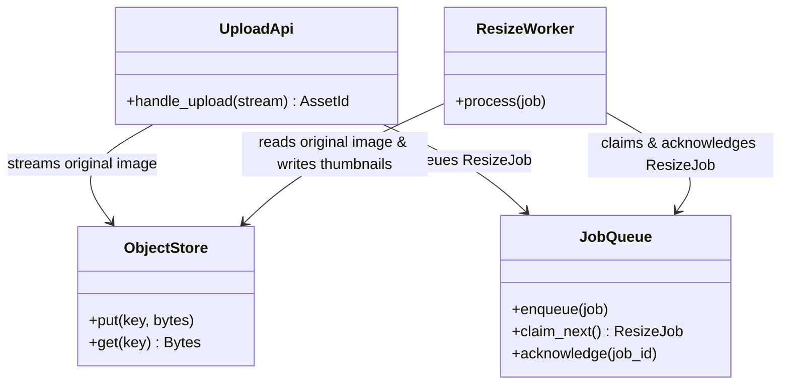
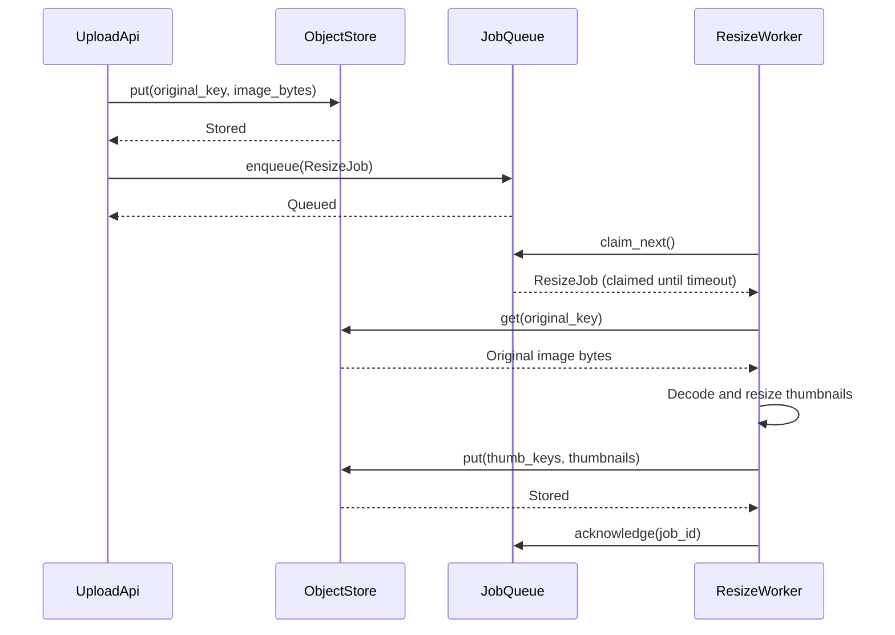
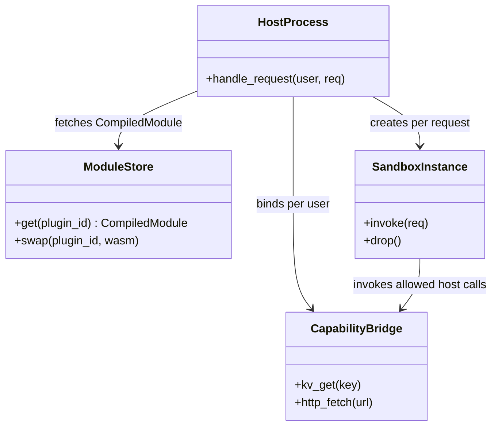
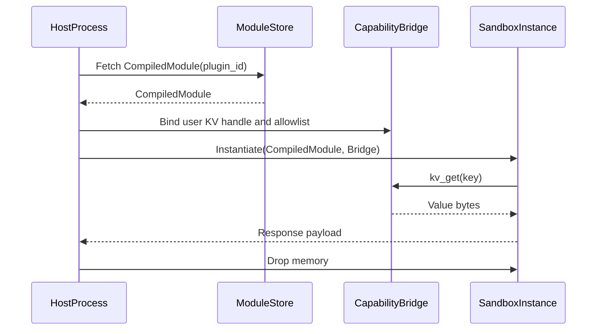
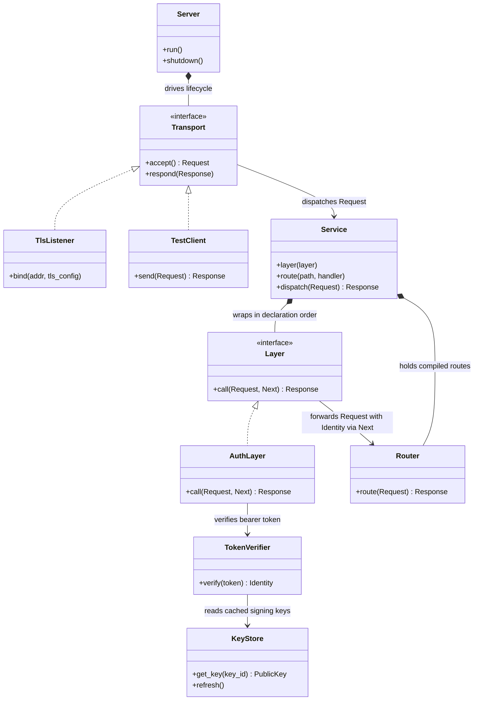
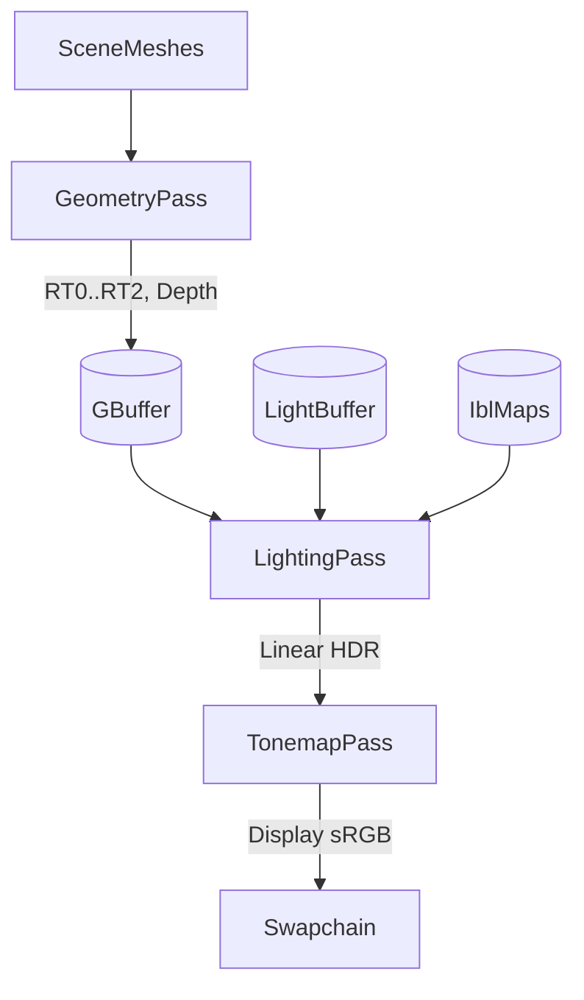

# Architecture Profile

*Read when writing or revising an overview of a system's architecture, a subsystem design, or a major boundary.*

## Goal

Build a mental model of how a system is structured and how its parts interact. A reader finishing an architectural overview should understand its core concepts, what each major part owns, how data or control flows across boundaries, and, where applicable, the limits or failure modes that shape the design.

## Guiding Structure

Adapt headings and section count to the system's domain concepts, introducing concepts and ownership before execution paths and edge cases. Across the whole page:

- Use concise, single-topic domain headings (`## Launchers`, `## Scene Identity`).
- Keep prose at conceptual altitude, referring to subsystems by plain role names (`the scene store`, `the upload API`, `the background worker`) instead of scattering internal struct names or `Type::method` calls across paragraphs.
- Explain concepts in prose before showing a short, import-free code or config snippet with unqualified names, letting the snippet carry syntax, attributes, and signatures instead of narrating them.

### Opening

- Establish what the system is, what it does, and the scope of the page. Lead directly with its role when the need is obvious, bridge from a neighboring concept when it complements another subsystem, or open with the motivating problem or paradigm when the design would otherwise look arbitrary.
- Keep the opening focused on the core idea. Include a load-bearing type when it clarifies the concept, or a short entry-point snippet when the page centers on a public or widely used internal API, saving internal types, deep mechanics, and edge cases for later sections.

### Core Concepts (Optional)

- When a system introduces several domain building blocks, a data model, or an authoring format, walk through them one single-topic section at a time before tying them together.
- Anchor abstract distinctions (such as definitions vs. instances, or layered identities) with a small concrete running example carried across the operations that follow.

### Ownership and Boundaries

- Continue from the opening or core concepts so the narrative develops the same thread rather than restarting cold.
- When an abstraction exists to absorb real-world quirks (divergent provider behavior, OS watcher noise, lock contention), lead that paragraph with a brief empirical explanation of what happens in practice rather than a chronological history of past attempts. For example: *"Operating system file watchers rarely emit one clean event per save. Editors write temporary files, rename them into place, and fire duplicate notifications within milliseconds. To avoid back-to-back rebuilds, the watch loop collapses rapid bursts into a single notification for the build runner."*
- Use a comparison table when ownership or transport shifts across deployment modes or reload boundaries.
- When static structure benefits from a visual, pair a UML Mermaid `classDiagram` with the prose (following `references/diagrams.md`), keeping exact component names in the diagram even while surrounding prose uses plain role names.

### Execution Flows (Optional)

- Include one or more flow sections whenever tracing runtime behavior helps the reader follow distinct triggers or lifecycles (such as startup, steady-state execution, or live reload).
- Trace each flow chronologically from trigger to completion, stating what triggers each handoff and what completes it. Lead with a one-sentence stage summary when a flow spans distinct phases.
- Pair a `sequenceDiagram` with the narrative when cross-component handoffs are easier to scan visually, and include secondary paths (such as retries or upgrades) when they share the same boundary contract.
- Add a concrete boundary struct or short code snippet where it clarifies a contract or API.

### Failure Boundaries and Limits (Optional)

- Cover concurrency rules (thread ownership, lock scopes, task draining, ordering) and failure modes (missing dependencies, dropped links, full storage, worker crashes) when they shape the system, including recovery bounds and where guarantees stop holding.

## Leave Out

- Proposal history, rejected options, feasibility debates, roadmaps, and task checklists (put those in a proposal or plan).
- Exhaustive method listings or function signatures that do not define a boundary between parts (put those in API docs).

## Examples

Four architectural overviews:

### Media Thumbnail Pipeline

````markdown
# Media Thumbnail Pipeline

When users open a project library, the asset browser displays preview grids without downloading full-resolution originals. These preview thumbnails are generated by the media service in the background. When a user uploads an image, the API endpoint writes the original file straight to object storage and queues a resize job for worker processes. Keeping image decoding off the API servers prevents large uploads from starving other traffic.

## Separating Uploads from Decoding

The upload API runs inside the API server, streaming each upload directly to object storage without decoding it and recording a resize job in the job queue once storage confirms the write. Object storage holds both original uploads and thumbnails, keyed by asset ID and target dimensions.

Separate resize worker processes handle decoding and resizing and scale independently of the API servers. Each worker pulls one job at a time from the job queue and writes the finished thumbnails back to object storage.



## Thumbnail Generation

Thumbnail generation runs in two stages: a synchronous upload path that persists the original file, followed by an asynchronous worker pass that produces the thumbnails. When a user uploads an image, the upload API validates the content type and size limit, streams the image bytes to object storage, and enqueues a resize job carrying the asset ID and object key. Once the queue accepts the job, the API returns the asset ID to the caller immediately.



In the background, an idle resize worker claims the job, fetches the original file from object storage, and generates each requested thumbnail size. The worker writes every thumbnail to storage before acknowledging completion to the queue. If a client requests a thumbnail before the worker finishes, the serving layer returns a placeholder or falls back to the original image until generation completes.

## Failure Recovery

When a worker takes a job, the queue hides it from other workers until a timeout expires. If a worker crashes or is killed before acknowledging the job, the queue makes that job available to another worker. Because thumbnail keys are deterministic and storage writes overwrite atomically, re-running a partial job produces the same objects without leaving half-written files behind.

Malformed uploads can still fail decoding or request excessive memory during decompression. Each worker checks image dimensions before allocating a decode buffer; after three failed attempts, the job queue moves the job to a dead-letter queue for inspection. At that point, the original upload remains in object storage, and the asset stays without thumbnails until an operator inspects or removes it.
````

### Plugin Sandbox Host

````markdown
# Plugin Sandbox Host

Agora supports admin-uploaded moderation plugins that screen new posts and query external blocklists before a post goes live. The plugin sandbox host runs those plugins inside the API gateway on each publish request. Spawning a fresh OS process per request would isolate untrusted code, but process startup would add tens of milliseconds to every call. Instead, the host runs extensions as WebAssembly modules in isolated memory. Each module compiles once on upload, and every request runs in a fresh sandbox.

## Runtime Lifetimes

Everything runs inside one server process. The gateway isolates extensions by separating shared runtime state from per-request memory. The host process owns the HTTP listener, worker threads, and WebAssembly engine, while the module store holds the compiled module for each uploaded plugin and shares it across worker threads.

User permissions and mutable memory live only for a single request. Before invoking an extension, the host binds a capability bridge scoped to the calling user, exposing only the handles that user may call (a namespaced key-value store, an HTTP allowlist, and a logger) rather than raw sockets or credentials. For each request, the host instantiates a fresh sandbox with its own memory backed by the stored module and that bridge, then drops the instance and its memory as soon as the call returns.



## Request Execution

When a request arrives, the host fetches the plugin's compiled module from the module store, binds a user-scoped capability bridge, and starts a sandbox instance. During execution, every host call routes through the bridge. Once the handler returns, the host drops the instance and reclaims its memory.



## Module Upgrades

When an admin uploads a new plugin version, the module store compiles the replacement binary in the background and swaps the stored module atomically. New requests pick up the updated module, while any in-flight sandbox finishes on the previous version before the host drops it.

## Execution Limits

Each sandbox runs with an execution timeout and a 64 MiB memory limit. Exceeding those limits or crashing stops only that instance: the host reclaims its memory, logs the error, and returns `502 Bad Gateway` for that request while other users continue unaffected.

Sandbox timeouts only trigger while WebAssembly code is running, not while an extension is blocked inside a host call. To keep a slow upstream from pinning a worker thread, every network and storage operation on the capability bridge enforces its own deadline.
````

### HTTP Services

````markdown
# HTTP Services

Every web service in Cobalt starts with a declarative `Service`—the entry point that wires routes, middleware, and request handlers into one definition without choosing how the process listens for traffic or terminates TLS.

```rust
pub fn service(verifier: TokenVerifier) -> Service {
  Service::new()
    .layer(TraceLayer)
    .layer(AuthLayer::new(verifier))
    .route("/orders", post(create_order))
    .route("/orders/{id}", get(get_order))
}
```

Layers wrap handlers in declaration order, so tracing measures the full request lifetime and authentication rejects unauthorized calls before route logic runs. Because `Service` builds a routing table and middleware chain without binding a socket, the same definition runs behind a production TLS listener, inside an in-memory test harness, or behind a serverless adapter.

## Middleware

Cross-cutting behaviors such as tracing, authentication, and rate limiting live in composable `Layer` implementations rather than inside individual handlers. Each layer receives the incoming request and a `Next` handle to the remainder of the chain, letting it short-circuit with an error response, attach typed data to the request's extension map, or inspect the outgoing response on the way back.

For example, when a client sends `POST /orders` with a bearer token and a JSON body, a custom `AuthLayer` validates the token against a `TokenVerifier` backed by a cached `KeyStore` rather than calling the identity provider on every call. When a token carries an unrecognized key ID, the key store triggers a bounded background refresh so key rotation takes effect without stalling active requests. On success, `AuthLayer` inserts the verified `Identity` into the request's extension map and forwards the request down the chain.

```rust
pub struct AuthLayer {
  verifier: TokenVerifier,
}

impl Layer for AuthLayer {
  async fn call(&self, request: Request, next: Next) -> Response {
    let Some(token) = request.bearer_token() else {
      return Response::unauthorized();
    };
    match self.verifier.verify(token).await {
      Ok(identity) => next.run(request.with_extension(identity)).await,
      Err(_) => Response::unauthorized(),
    }
  }
}
```

## Extractors

Downstream handlers do not read raw headers, byte streams, or the extension map directly. An *extractor* parses one typed input from an incoming request so route handlers can declare the values they need as function parameters. Before invoking a handler, the router runs each parameter's extractor and returns a `400` or `401` response if extraction fails.

For that `POST /orders` request, `create_order` extracts the `Identity` that `AuthLayer` attached alongside the deserialized `NewOrder` JSON body:

```rust
async fn create_order(identity: Identity, body: Json<NewOrder>) -> Response {
  Order::create(identity.user_id, body.0).into_response()
}
```

## Transports

On its own, a `Service` is a passive definition. Handling live traffic requires a transport to adapt an external protocol or runtime environment into Cobalt's uniform request and response types, keeping socket management and HTTP framing out of handlers and middleware:

| Transport | Connection source | Binds socket | Typical use |
| --- | --- | :---: | --- |
| `TlsListener` | TCP listener with TLS termination | Yes | Production services behind `Server` |
| `TestClient` | Direct in-memory calls | No | Integration tests with local verifiers |
| `ServerlessAdapter` | Platform event invocation | No | Function-as-a-service deployments |

In production, `Server` drives a `TlsListener` and coordinates graceful shutdown. In automated tests, a `TestClient` dispatches requests in memory against the same `Service` backed by a local test verifier, without opening sockets or claiming ports.

```rust
// Production binary
let verifier = TokenVerifier::new(KeyStore::from_jwks(jwks_url));
Server::new(service(verifier))
  .bind_tls("0.0.0.0:443", tls_config)
  .run()
  .await?;

// Integration test
let client = TestClient::new(service(TokenVerifier::for_test(test_key)));
let response = client.post("/orders").bearer(test_token).send().await;
```

## Putting It Together

At runtime, the server owns the active transport and drives its lifecycle, while the service wraps its compiled router inside the registered middleware stack. Custom layers such as `AuthLayer` rely on injected collaborators like `TokenVerifier` and `KeyStore` to validate requests and enrich them before handing off to the router:


````

### Physically Based Lighting

````markdown
# Physically Based Lighting

The renderer shades 3D surfaces using a *physically based rendering* (PBR) pipeline that evaluates materials with an approximate model of how light reflects off real surfaces. Artists author lighting-independent surface parameters such as base color, roughness, and metallic response once, and the pipeline shades them consistently across outdoor sun, indoor point lights, and changing environments.

## Prior Shading Models

Early real-time renderers shaded surfaces with empirical models such as Phong ([Phong, 1975](https://doi.org/10.1145/360825.360839)) and Blinn-Phong ([Blinn, 1977](https://doi.org/10.1145/563858.563893)). Blinn-Phong added a Lambertian diffuse color to a specular highlight controlled by a hand-tuned specular color and a shininess exponent driven by the halfway vector between the light and camera. Those models were cheap to compute and easy to tune for a single lighting setup, but nothing linked a highlight's width to its brightness or capped total reflection at incoming light energy. Widening a highlight did not dim it, and bright diffuse and specular terms could sum to more energy than the surface received, so materials adjusted under overcast skies often looked plastic or clipped under direct sunlight.

## Microfacets and Roughness

Physically based shading replaces those ad-hoc controls with a model of surface geometry derived from optical microfacet theory ([Torrance and Sparrow, 1967](https://doi.org/10.1364/JOSA.57.001105)). At a microscopic scale, even visually flat surfaces consist of tiny mirror-like tilts called *microfacets*. A single *roughness* parameter controls how tightly those microfacets align with the surface normal. On polished copper, microfacets align closely and concentrate incoming light into a sharp, bright reflection. On matte clay, microfacets point in scattered directions and spread that same incoming energy into a wide, dim highlight.

## The BRDF

A *Bidirectional Reflectance Distribution Function* (*BRDF*) formalizes that surface response at each shaded point: given an incoming light direction `l` and a view direction `v`, what fraction of incoming radiance reflects toward the camera? Our lighting shader combines a Lambertian diffuse term with a Cook-Torrance microfacet specular term ([Cook and Torrance, 1982](https://doi.org/10.1145/357290.357293)):

$$f(l, v) = k_d \frac{c}{\pi} + \frac{D(h)\,G(l, v)\,F(v, h)}{4\,(n \cdot l)(n \cdot v)}$$

Here `c` is the surface base color, `k_d` is the diffuse energy weight, `n` is the surface normal, and `h` is the halfway vector between `l` and `v`. The specular numerator multiplies three physical factors, divided by `4 (n · l)(n · v)` to normalize reflection between the microfacet and macrosurface geometry:

- **Normal distribution (`D`):** Estimates the fraction of microfacets aligned with `h` based on roughness, using the GGX distribution ([Walter et al., 2007](https://doi.org/10.2312/EGWR/EGSR07/195-206)).
- **Geometry masking and shadowing (`G`):** Accounts for microfacets that block incoming light or occlude reflected rays at grazing angles, using the paired Smith masking-shadowing term.
- **Fresnel reflectance (`F`):** Increases surface reflectivity as the viewing angle becomes shallower, approximated with Schlick's polynomial ([Schlick, 1994](https://doi.org/10.1111/1467-8659.1330233)) so even rough surfaces turn mirror-like near grazing edges.

## Metallic Workflow and Energy Conservation

Two physical rules connect artist-authored textures to the BRDF. First, *energy conservation* requires that reflected light never exceed incoming light. Whatever fraction `F` reflects specularly at the surface leaves the remaining energy (`k_d`) to refract into the material and scatter out as diffuse light.

Second, insulators (dielectrics such as clay, wood, and plastic) behave differently from conductors (metals such as copper, gold, and iron). Dielectrics reflect a small, untinted specular fraction at the surface and tint the refracted diffuse light with their base color. Metals absorb refracted light immediately, setting `k_d` to zero, and tint their specular reflection with their base color. Following the Disney principled parameterization ([Burley, 2012](https://blog.selfshadow.com/publications/s2012-shading-course/burley/s2012_pbs_disney_brdf_notes_v3.pdf)), a single `metallic` parameter blends between the two responses during shading, letting one material representation cover both clay and copper without separate shaders.

## Direct and Image-Based Lighting

Evaluating analytical lights (directional sun, point lights, spotlights) covers direct illumination, but leaves shadowed areas pitch black because real surfaces also receive bounced light from every direction around them. *Image-based lighting* (IBL) approximates that ambient environment from a surround cubemap pre-integrated offline into two lookup textures:

- **Irradiance cubemap:** Convolves the environment over the full hemisphere for low-frequency diffuse bounce light.
- **Prefiltered radiance cubemap:** Stores progressively blurred environment mip levels indexed by roughness, paired with a precomputed 2D split-sum BRDF lookup table for glossy reflections ([Karis, 2013](https://blog.selfshadow.com/publications/s2013-shading-course/karis/s2013_pbs_epic_notes_v2.pdf)).

## Deferred Lighting Pipeline

Shading every triangle in a complex scene wastes BRDF evaluations on fragments later hidden behind closer geometry. Our renderer splits opaque rendering into a geometry pass and a screen-space lighting pass connected by a *G-buffer*, evaluating the BRDF once per visible pixel:

| Target | Channels | Contents |
| --- | --- | --- |
| `RT0` | `RGB8` + `A8` | Base color and ambient occlusion |
| `RT1` | `RGB10A2` | Encoded world-space normal |
| `RT2` | `RG8` | Roughness and metallic scalars |
| `Depth` | `D32F` | Hardware depth used to reconstruct world position |

The geometry pass writes material parameters into the G-buffer. The lighting pass reconstructs each pixel's world position from depth, accumulates direct light contributions from the active light buffer alongside IBL lookups into a linear HDR target, and hands that HDR image to the tone-mapping pass for display conversion:


````
